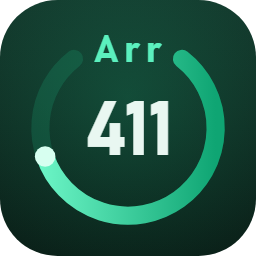

<p align="center">
  
</p>

<h1 align="center">Arr411</h1>

<p align="center">
  An all-in-one Android app for <b>C411</b>: browse the tracker, send torrents to <b>qBittorrent</b> with the category you choose,
  and manage <b>Radarr</b>, <b>Sonarr</b> and <b>Lidarr</b>, all in one place.
</p>

<p align="center">
  
  
  
  
  
  
</p>

<p align="center">
  <b>C411</b> · <b>Radarr</b> · <b>Sonarr</b> · <b>Lidarr</b> · <b>qBittorrent</b>: one tab each, one bottom bar.
</p>

> The app's interface is in French, like C411.

---

## ✨ Features

### 🌐 C411
- The full **C411 website**, with the [C411 → qBittorrent](https://github.com/HugoMeyer/arr411-chrome) extension built in.
- **qBittorrent button** next to C411's **Télécharger** button on torrent pages, and at the end of each row in result lists.
- **Send dialog**: qBittorrent category, add paused, and **add to Radarr, Sonarr or Lidarr** in the same step, with the root folder, the series type (Standard, Anime, Daily), or the album / artist for music.
- Detects the **IMDb, TMDB and TheTVDB** IDs on the torrent page, and the album from C411's music card (MusicBrainz, Deezer and Discogs links).
- Handles C411's **"Téléchargement normal"** prompt automatically when it appears.
- **Badges** for torrents already in qBittorrent (`✔ qBit` / `⇩ 42 %`) in result lists, plus a status badge on torrent pages.
- **Quick menu** (tap the C411 tab again): reload, C411 home, desktop mode, copy or share the link, settings.

### ⬇️ qBittorrent
- Torrent list with live **speeds** and **free space**, filters (downloading, seeding, completed, paused, active, stalled, errors), **categories and tags**, search and many sort orders.
- **Multi-select** with bulk actions.
- **Torrent details** with *Infos*, *Fichiers* (priorities, rename), *Trackers* and *Pairs* (peers) tabs.
- **Actions**: pause / resume, force resume, recheck, reannounce, category, tags, move, rename, speed and share limits, sequential download, queue priority, copy magnet links, delete with or without files.
- **Add torrents** from magnet links, URLs or `.torrent` files: category, tags, save path, add paused, sequential download, first and last pieces first, skip hash check, content layout, rename, speed limits.
- **Global speed limits** and **alternative speed** mode.
- **Categories and tags manager**, **qBittorrent preferences**, **log**, and a shortcut to the WebUI.
- **Importer dans Radarr / Sonarr / Lidarr…**: manual import of a finished torrent, straight from its menu.
- **Voir la fiche sur C411** and **Rechercher sur C411** from a torrent's menu.

### 🎬 Radarr · 📺 Sonarr · 🎵 Lidarr
- **Library** in grid or list view, with filters (downloaded, missing, not released yet, complete, continuing, anime…) and sort options.
- **Detail pages**: movie info, files and history; seasons and episodes; artist discography with albums and tracks (multi-disc aware).
- **Add** by searching a title or pasting an IMDb, TMDB, TheTVDB or MusicBrainz link or ID. Choose the root folder, quality profile, tags, series type, and for Lidarr the metadata profile and a single album or just the artist.
- **Edit**, **rename files**, **retag** audio files (Lidarr), **delete** (optionally with files and an import exclusion).
- **Activity**: queue and history, plus **manual import** with per-file matching (movie, episode, or album and track). *Copier* uses a hardlink when possible, so the torrent keeps seeding.
- **Calendar** of upcoming releases.
- **System**: status, health, disk space, scheduled tasks, logs, blocklist, tags, backup, root folders (with import of existing folders), quality profiles editor, and Lidarr metadata profiles.
- **Chercher sur C411** on every movie, series, episode, artist and album: opens the C411 tab with the search already filled in.
- **Tout passer en non surveillé**: unmonitors the whole library in one tap.
- 🛡️ **Never monitored, never searched.** Everything Arr411 adds is **unmonitored**, and the app **never triggers a search or an RSS sync**. Radarr, Sonarr and Lidarr never download anything on their own. C411 stays your only source.

### 🔗 Links and sharing
- **c411.org links** open in the C411 tab, and **magnet links** and **`.torrent` files** open qBittorrent's add sheet.
- **Share** to Arr411 from any app:

| Shared content | Goes to |
|---|---|
| Magnet link, `.torrent` URL or file | qBittorrent |
| c411.org link | C411 tab |
| TMDB movie link | Radarr |
| TMDB TV or TheTVDB series link | Sonarr |
| MusicBrainz artist, release-group or release link | Lidarr |
| IMDb link or `tt…` ID | Radarr or Sonarr (you choose) |
| Any other text | C411 search |

### 🔔 Notifications and design
- **Notification** when a torrent sent from C411 finishes downloading (optionally for every torrent).
- **Badge** with the number of active downloads on the qBittorrent tab.
- **Dark, green interface** inspired by C411. The bottom bar hides while you type.
- **Long-press** the Radarr, Sonarr, Lidarr or qBittorrent tab to jump to its settings.

---

## 📦 Installation

Arr411 is not on the Play Store. Install the APK yourself:

1. Download `Arr411.apk` from the [**Releases**](https://github.com/HugoMeyer/arr411-android/releases) page of this repository, or build it yourself (see *Building from source* below).
2. Open it on your phone. When Android asks, allow your browser or file manager to install unknown apps.
3. Launch **Arr411**, sign in to C411 in the **C411** tab, then fill in your servers in the settings.

> Requires **Android 10** or later. To update, install the new APK over the old one: your settings are kept.

---

## ⚙️ Configuration

Open **Réglages** from any tab's menu, or long-press a tab in the bottom bar.

| Card | Settings |
|---|---|
| **qBittorrent** | WebUI URL, username (leave empty if authentication is disabled), password → **Enregistrer et tester**; default category |
| **Radarr** *(optional)* | URL, API key → **Enregistrer et tester**; default quality profile, default root folder, qBittorrent category |
| **Sonarr** *(optional)* | Same as Radarr |
| **Lidarr** *(optional)* | Same, plus the default metadata profile; the qBittorrent category is `lidarr` by default |
| **C411** | List badges, desktop mode, startup tab (C411, Radarr, Sonarr, Lidarr, qBittorrent or the last one used) |
| **Notifications** | Download completed; for all torrents, not only those sent from C411 |

- API keys are under **Settings → General → Security** in Radarr, Sonarr and Lidarr.
- URLs can be LAN addresses (`http://192.168.1.10:8080`) or HTTPS domains. Your phone must be able to reach them: same Wi-Fi, a VPN, or a public domain.
- The root folder is asked every time you add something, so you can keep anime and series apart. The default one is just pre-selected.
- Lidarr's **metadata profile** decides which albums are listed for a newly added artist. The built-in `None` profile keeps only the albums you add.

---

## 🚀 Usage

### From C411
1. Open a torrent page, or a results list, in the **C411** tab.
2. Tap **qBittorrent**.
3. Choose:
   - **Add to:** Radarr, Sonarr, Lidarr, or nothing *(torrent page only)*
   - **Root folder**, plus the **series type** for Sonarr, or **album / artist only** (with editable names) for Lidarr
   - **qBittorrent category**
   - **Add paused** *(optional)*
4. Tap **Envoyer**. A toast confirms that the torrent was sent and that the title was added.

### From Radarr, Sonarr or Lidarr
1. Tap **+** and search a title, or paste an IMDb, TMDB, TheTVDB or MusicBrainz link.
2. Pick the root folder and profiles, then tap **Ajouter**. The item is added unmonitored.
3. Tap **Chercher sur C411** to find a release, then send it from the C411 tab.

### Once the download is done
- If your \*arr app watches the torrent's qBittorrent category, it can import the files on its own.
- Otherwise, open the torrent's menu in the **qBittorrent** tab and choose **Importer dans Radarr / Sonarr / Lidarr…**.

> Tip: share a TMDB, IMDb or MusicBrainz link from your browser to Arr411 to add it directly.

---

## 🔧 How it works

```
C411 tab ─────── c411.org in a WebView + the extension's content.js
   │  window.QbtPage (a short whitelist of messages)
   ▼
Engine ───────── hidden WebView running the extension's background.js
   │
   ├──▶ qBittorrent WebUI API (/api/v2/torrents/add)
   └──▶ Radarr / Sonarr / Lidarr API (add, unmonitored)

Other tabs ───── web app served from the APK at https://arr411.local/app/
   │  window.Native
   ▼
Native HTTP ──── the same APIs, plus a cover proxy with a disk cache
```

- **Same code as the extension.** `background.js`, `content.js` and `page-hook.js` are copied from the Chrome extension at build time. Small shims (`shim-engine.js`, `shim-page.js`) provide the `chrome.*` APIs they use.
- **No C411 credentials needed.** The app reuses C411's own download button with your logged-in session, then fetches the `.torrent` natively with the WebView's cookies.
- **Native HTTP.** Requests to your servers are made in Java, so there's no CORS, `http://` LAN addresses work, and the `Origin` and `Referer` headers that qBittorrent's CSRF protection expects are set.
- **Covers** from Radarr, Sonarr and Lidarr go through a local proxy that adds the API key, so the key never appears in image URLs. They're cached for a week (about 150 MB max).
- **Two WebViews behind a native bottom bar**: the C411 page keeps its state while you switch tabs. If Android kills a WebView under memory pressure, the app rebuilds itself instead of crashing.

---

## 🔐 Permissions and privacy

| Permission | Why |
|---|---|
| `INTERNET` | Reach C411 and your qBittorrent, Radarr, Sonarr and Lidarr servers |
| `POST_NOTIFICATIONS` | Download-completed notifications (asked at first launch on Android 13+) |

- Settings, passwords and API keys are stored in the app's **private storage**, excluded from Android backups, and only sent to your own servers.
- The C411 page **never sees them**: it can only send a short whitelist of messages to the app (categories, status, send).
- Cleartext `http://` is allowed so LAN addresses work. Prefer HTTPS for anything exposed to the internet.
- No analytics, no tracking. Besides C411 and your servers, the app only contacts the public **MusicBrainz** API (to match C411 music releases for Lidarr) and, as a fallback, the image servers your \*arr apps use for posters.

---

## 🛠️ Building from source

No Gradle or Android Studio: just a JDK, the Android SDK command-line tools, and a Windows PowerShell script.

**Requirements**
- JDK 17 (for example Eclipse Temurin)
- Android SDK `build-tools;34.0.0` and `platforms;android-34`
- The [arr411-chrome](https://github.com/HugoMeyer/arr411-chrome) repository, cloned next to this one: `background.js`, `content.js` and `page-hook.js` are packed into the app

**Folder layout** expected by `build.ps1`:

```
Github Repos\                   any parent folder works
├─ android-toolchain\           yours, not in a repository
│  ├─ jdk\                      JDK 17
│  └─ sdk\
│     ├─ build-tools\34.0.0\
│     └─ platforms\android-34\
├─ arr411-chrome\               the Chrome extension
└─ arr411-android\              this repository
```

The SDK packages can be installed with the command-line tools, from this repository's folder:

```powershell
sdkmanager --sdk_root=..\android-toolchain\sdk "build-tools;34.0.0" "platforms;android-34"
```

Prefer other locations? Set the `ARR411_TOOLCHAIN` environment variable to the toolchain folder, and `ARR411_EXTENSION` to the extension folder.

**Build**

```powershell
cd arr411-android
powershell -ExecutionPolicy Bypass -File build.ps1
```

The script compiles the resources (aapt2), the Java code (javac, then d8), packs the extension and the web app as assets, then aligns and signs the APK. The result is `Arr411.apk` in the repository folder, also copied to your **Downloads** folder.

> 🔑 **Signing.** The first build creates `signing.keystore`. Back it up and **never commit it** (it's in `.gitignore`): Android only accepts an update signed with the same key. If you publish your own builds, change the keystore password in `build.ps1` too.

---

## 🩹 Troubleshooting

| Problem | Fix |
|---|---|
| `Failed to fetch` or another connection error | The phone can't reach the server. Check the URL (`http://` or `https://`, port included) and your network or VPN, then tap **Enregistrer et tester**. |
| `Connexion qBittorrent refusée` | Wrong username or password, or qBittorrent banned the IP after failed logins. A refused login isn't retried with the same credentials for 10 minutes. |
| `Fichier .torrent expiré` | The download link from C411 expired. Reload the page and tap **qBittorrent** again. |
| Categories don't load | Configure qBittorrent in the settings, then tap **Enregistrer et tester**. |
| Radarr, Sonarr or Lidarr is greyed out in the C411 dialog | The service isn't configured in the settings. |
| `Cette adresse répond « … » et pas …` | The URL points to another app (for example Sonarr's URL in the Radarr card). |
| Lidarr lists too many albums for a new artist | Use a narrower metadata profile. `None` keeps only the albums you add. |
| No completion notification | Allow notifications for Arr411 in Android's settings. Checks run while the app is open or in the background, and Android may stop them after a while. |
| "App not installed" when updating | The new APK was signed with another key. Uninstall the old version first (its settings are lost). |

---

## 📁 Project structure

Paths are relative to the repository root.

```
AndroidManifest.xml     Package, permissions, intent filters (C411 links, magnets, .torrent files, sharing)
build.ps1               Gradle-free build: aapt2 → javac → d8 → zipalign → apksigner
src/dev/c411/qbittorrent/
  MainActivity.java     Two WebViews (C411 and the web app), bottom bar, intents, back navigation
  NavBar.java           Bottom bar with the active-downloads badge
  Engine.java           Hidden WebView running background.js: native HTTP, storage, notifications
  PageBridge.java       window.QbtPage for the C411 tab (whitelisted messages, native .torrent download)
  SpaBridge.java        window.Native for the web app
  SpaClient.java        Serves the web app at https://arr411.local/app/, proxies and caches covers
  Shared.java           Turns shared links and .torrent files into app actions
app/                    Web app (plain JavaScript, no build step)
  index.html, app.css   Shell and theme
  logo.png              Logo shown in Settings → About
  core.js, icons.js     UI toolkit, API clients and icons
  qbit.js, qbit-more.js qBittorrent tab
  arr.js, arr-more.js   Radarr, Sonarr and Lidarr screens: library, add, activity, calendar, import, system
  lidarr.js             Lidarr specifics: artists, albums, tracks, metadata profiles
  settings.js, main.js  Settings, startup and shared-link routing
assets-extra/           engine.html and the chrome.* shims for the extension
res/                    Launcher icon, bottom-bar icons, theme
docs/icon.png           Logo used in this README
```

---

## 📄 License

Released under the [MIT License](LICENSE). The icons come from [Heroicons](https://heroicons.com) (MIT, Tailwind Labs): see [THIRD_PARTY_NOTICES.md](THIRD_PARTY_NOTICES.md).

---

## ⚠️ Disclaimer

This is an unofficial, personal project. It is not affiliated with C411, qBittorrent, Radarr, Sonarr, Lidarr or MusicBrainz. Use it in line with your tracker's rules and the laws of your country.
